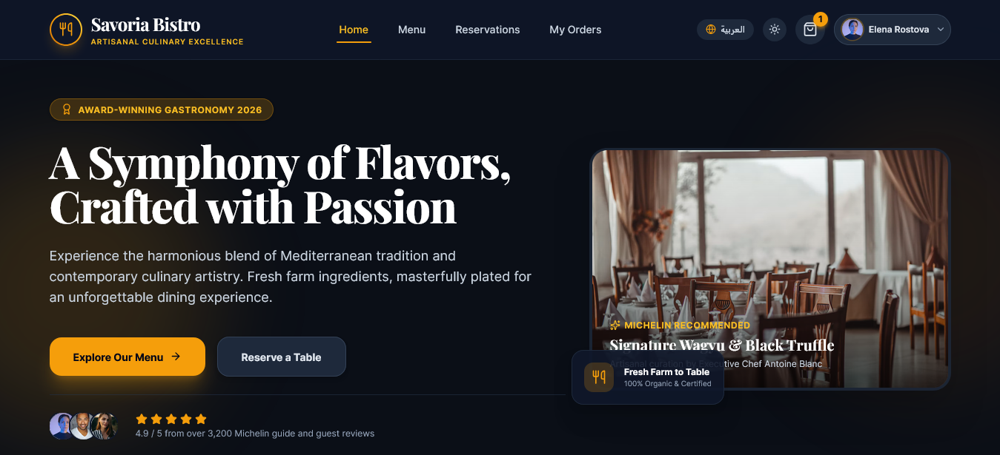

# Savoria Restaurant Website

Savoria is a modern restaurant website built with React, Vite, Tailwind CSS, and Framer Motion. It delivers a polished dining experience with multilingual support, responsive layouts, interactive menu browsing, reservation booking, cart and checkout flows, order history, dark mode, and an admin dashboard.



## Overview

This project is a front-end restaurant experience designed to showcase premium dining branding and user-friendly interactions. The interface includes a dynamic landing page, menu exploration with category filtering, reservation management, shopping cart functionality, and administrative tools for restaurant management.

## Features

- Elegant landing page with hero section, chef specials, restaurant story, and testimonials
- Interactive menu with category filtering, search, and dietary options
- Detailed dish cards with ingredient and nutrition context
- Reservation booking flow for table selection and scheduling
- Shopping cart and checkout experience
- Order history tracking for past purchases
- Login and registration modals for customer interactions
- Dark mode toggle for improved usability
- English and Arabic language switch support
- Admin dashboard for managing restaurant operations
- Smooth motion and transitions using Framer Motion

## Tech Stack

- React
- Vite
- JavaScript
- Tailwind CSS
- Framer Motion
- Lucide React
- Canvas Confetti

## Project Structure

```bash
restaurant-website/
├── public/
├── src/
│   ├── assets/
│   ├── components/
│   │   ├── auth/
│   │   ├── cart/
│   │   ├── common/
│   │   └── ...
│   ├── context/
│   ├── data/
│   ├── hooks/
│   ├── pages/
│   ├── styles/
│   ├── App.jsx
│   ├── index.css
│   ├── main.jsx
│   └── ...
├── .gitignore
├── index.html
├── jsconfig.json
├── package.json
├── package-lock.json
├── postcss.config.js
├── README.md
├── tailwind.config.js
├── vite.config.js
└── ...
```

## Getting Started

### Prerequisites

Make sure you have the following installed:

- Node.js v18 or later
- npm

### Installation

```bash
git clone https://github.com/baselserhan/restaurant-website.git
cd restaurant-website
npm install
```

### Run the App in Development Mode

```bash
npm run dev
```

Then open the local URL provided in the terminal, typically:

```bash
http://localhost:5173
```

### Production Build

```bash
npm run build
```

### Preview Production Build

```bash
npm run preview
```

## Usage

- Browse the homepage to view the restaurant story, menu highlights, and promotional sections
- Explore the menu with filters and sorting options
- Add items to the cart and proceed through checkout
- Book a table through the reservation experience
- View order history and account-related actions
- Switch between light and dark theme modes and language preferences

## Design Highlights

- Premium branding and modern dining aesthetic
- Responsive layout for desktop, tablet, and mobile screens
- Clear visual hierarchy with accessible UI elements
- Animated interfaces and motion-enhanced transitions
- User-focused experiences for browsing, ordering, and reservation flows

## Contributing

Contributions are welcome. If you want to improve the project, feel free to fork the repository, create a feature branch, and submit a pull request.

## License

This project is licensed under the MIT License. See the LICENSE file for details if available in your local copy.

## Contact

For questions, suggestions, or collaboration opportunities, feel free to reach out through the repository or project maintainer profile.
